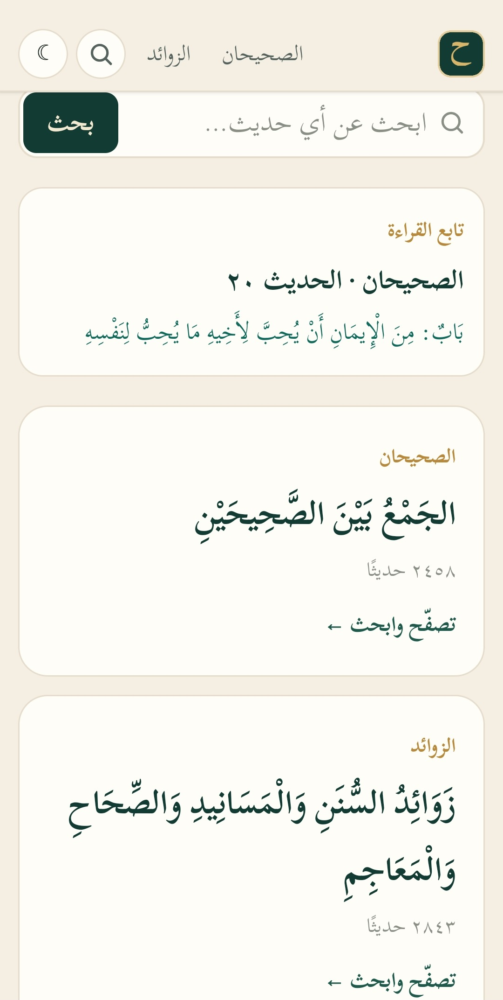
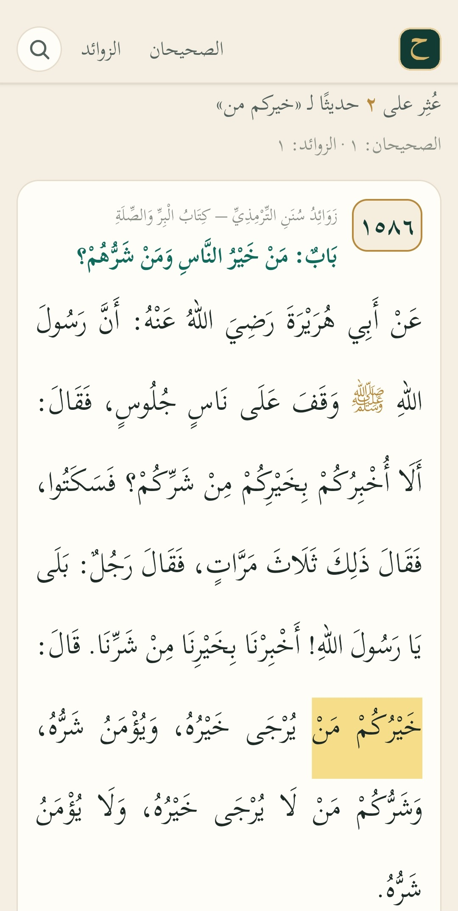
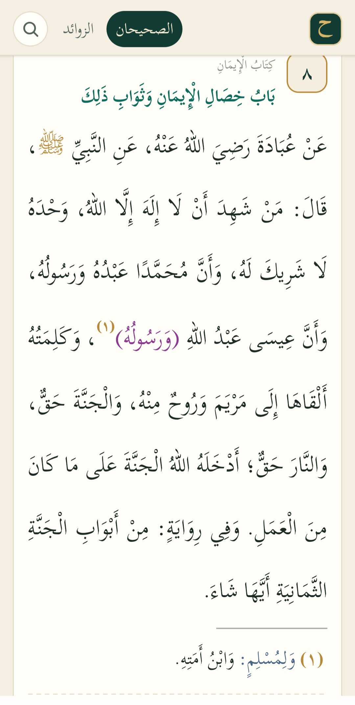

# حفظ السنة

**🌐 الويب:** [hadeeth.pages.dev](https://hadeeth.pages.dev)  
**📱 أندرويد:** [تحميل أحدث إصدار (APK)](../../releases/latest)

تطبيق للبحث في أحاديث كتاب «مُحَصِّلُ دَوَاوِينِ السُّنَّةِ الثَّمَانِيَةَ عَشَرَ» للشيخ يحيى بن عبد العزيز اليحيى (طبعة دار الرفقة)، وهو قسمان: «الجمع بين الصحيحين» و«زوائد السنن والمسانيد والصحاح والمعاجم».
يُكتب البحث بلا حركات، ويظهر الحديث مشكولًا كاملًا مع الحواشي كما في المطبوع، وأرقام الأحاديث موافقة للطبعة.

  
  
  

## دواوين السنة الثمانية عشر

**الصحيحان**
1. صحيح البخاري
2. صحيح مسلم

**السنن الخمس**

3. سنن أبي داود
4. سنن الترمذي
5. سنن النسائي الصغرى (المجتبى)
6. سنن ابن ماجه
7. سنن الدارمي

**المسانيد الخمسة**

8. مسند أحمد
9. مسند ابن أبي شيبة
10. مسند إسحاق بن راهويه
11. مسند البزار
12. مسند أبي يعلى

**الصحاح الثلاثة**

13. صحيح ابن خزيمة
14. صحيح ابن حبان
15. المستدرك على الصحيحين للحاكم

**معاجم الطبراني الثلاثة**

16. المعجم الكبير
17. المعجم الأوسط
18. المعجم الصغير

## المحتوى

| المجلد | الوصف |
|---|---|
| `web/` | تطبيق الويب (React و Vite و TypeScript) |
| `web/public/data/hadith.json` | البيانات التي يقرؤها التطبيق: ما يُحفظ فقط، بلا تخريج |
| `web/data/hadith_full.json` | البيانات الكاملة مع التخريج (لا يحمّلها التطبيق) |
| `android/` | تطبيق أندرويد (Kotlin)، يعمل بلا إنترنت |

## التشغيل

**الويب:** `cd web` ← `npm install` ← `npm run dev` (أو `npm run build` للنشر من `dist/`)

**أندرويد:** افتح مجلد `android/` في Android Studio. البيانات في `app/src/main/assets/data/hadith.json`.

